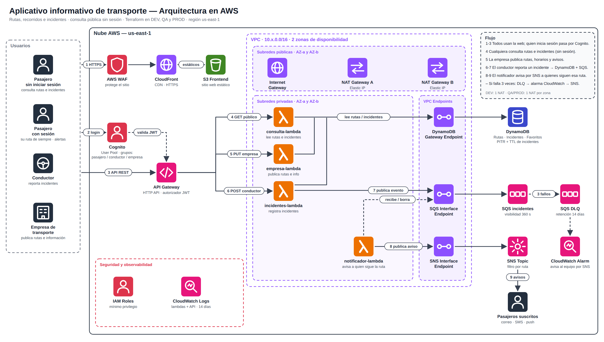

# Transporte Info — aplicativo informativo de transporte en AWS (Terraform)

Aplicativo **informativo** sobre recorridos e incidentes del transporte urbano:

- **Pasajeros** consultan rutas, paraderos e incidentes **sin iniciar sesión**. Si inician sesión, guardan su *ruta de siempre* y reciben avisos por correo.
- **Conductores** inician sesión y **reportan incidentes** (accidente, congestión, desvío, obra…).
- **Empresas de transporte** inician sesión y **publican su información**: rutas, horarios, tarifas, paradas y estado.

Todo se despliega con Terraform en **tres entornos independientes: DEV, QA y PROD**.



> El diagrama editable está en `docs/arquitectura-transporte.excalidraw` (abrir en https://excalidraw.com) y en SVG.

## Cómo funciona

| # | Paso |
|---|------|
| 1 | El usuario abre la web: **WAF → CloudFront → S3** (sitio estático). |
| 2 | Quien quiere reportar o publicar inicia sesión en **Cognito** (grupos `pasajero`, `conductor`, `empresa`). |
| 3 | La web llama al **API Gateway** (HTTP API). Las rutas de consulta son públicas; el resto exige el token JWT de Cognito. |
| 4 | `consulta-lambda` lee rutas e incidentes de **DynamoDB** (y gestiona las rutas favoritas). |
| 5 | `empresa-lambda` guarda las rutas que publica la empresa (solo su dueña puede editarlas). |
| 6 | `incidentes-lambda` guarda el incidente en DynamoDB (con **TTL**) y publica un evento en **SQS**. |
| 7 | `notificador-lambda` lee SQS y publica en **SNS** con el atributo `ruta`; cada suscriptor solo recibe los avisos de sus rutas favoritas. |
| – | Si un mensaje falla 3 veces va a la **DLQ** y una alarma de **CloudWatch** avisa por SNS. |

Las Lambdas corren en **subredes privadas de 2 zonas de disponibilidad** y llegan a DynamoDB (Gateway Endpoint), SQS y SNS (Interface Endpoints) sin salir a Internet.

## Estructura

```
modules/transporte/   Módulo único con todos los recursos (red, DynamoDB, SQS/SNS, Cognito, API, Lambdas, CloudFront, WAF, alarmas)
envs/dev|qa|prod/     Un entorno = una carpeta, con su propio estado y valores
lambdas/src/          Código Node.js 20 de las 4 funciones (sin dependencias: usa el SDK incluido en Lambda)
frontend/             Web estática (index.html, app.js, styles.css); Terraform genera config.js con las URLs reales
scripts/              crear-usuarios y probar (PowerShell y bash)
tests/run.js          Pruebas de las Lambdas con AWS simulado (node tests/run.js)
docs/                 Diagrama y guía de evidencias
```

| | DEV | QA | PROD |
|---|---|---|---|
| CIDR de la VPC | 10.0.0.0/16 | 10.1.0.0/16 | 10.2.0.0/16 |
| NAT Gateways | 1 (ahorro) | 2 (uno por zona) | 2 (uno por zona) |
| Límite del API | 50 rps | 500 rps | 2 000 rps |
| TTL de incidentes | 3 días | 7 días | 14 días |
| Retención de logs | 7 días | 14 días | 30 días |

Todos los recursos se llaman `transporte-info-<entorno>-…`, así que los tres entornos pueden convivir en la misma cuenta.

## Requisitos

- [Terraform](https://developer.hashicorp.com/terraform/install) ≥ 1.5 y [AWS CLI v2](https://aws.amazon.com/cli/).
- Credenciales (o AWS CloudShell, que ya viene autenticado) y comprobar con `aws sts get-caller-identity`.
- **No hace falta Node.js ni npm** para desplegar (solo para correr `tests/run.js`).
- Región por defecto **us-east-2**, porque la cuenta de laboratorio bloquea us-east-1 con una SCP. Se cambia en `terraform.tfvars` (`region`).
- **WAF opcional** (`enable_waf`, por defecto `false`): el WAF de CloudFront solo existe en us-east-1. Si tu cuenta permite esa región, pon `region = "us-east-1"` y `enable_waf = true`.

## Despliegue (PowerShell)

```powershell
cd envs\dev          # o envs\qa, envs\prod
terraform init
terraform plan
terraform apply      # escribir "yes" (tarda ~10 min por CloudFront)
terraform output
```

Salidas útiles: `web_url` (la web), `api_url`, `login_url`, `account_id`.

### Usuarios de prueba

Cualquiera puede registrarse como pasajero desde la web. Los roles **conductor** y **empresa** solo los asigna un administrador:

```powershell
cd ..\..             # raíz del proyecto
.\scripts\crear-usuarios.ps1 -Env dev
```

Crea `pasajero.dev@ejemplo.pe`, `conductor.dev@ejemplo.pe` y `empresa.dev@ejemplo.pe` (contraseña `Transporte2026`). En bash: `./scripts/crear-usuarios.sh dev`.

### Probar

1. **Web:** abre `web_url`. Verás las 3 rutas de ejemplo sin iniciar sesión. Entra con el conductor y reporta un incidente; entra con la empresa y publica una ruta.
2. **Línea de comandos** (queda como evidencia):

```powershell
.\scripts\probar.ps1 -Env dev      # bash: ./scripts/probar.sh dev
```

   Consulta pública → intento sin token (401) → el conductor reporta → el pasajero es rechazado (403) → el incidente aparece en la consulta pública.
3. **Avisos por correo:** con un pasajero real (correo verificado), en *Mis rutas* marca una ruta y guarda; confirma el correo de Amazon SNS. Cuando un conductor reporte un incidente en esa ruta llegará el aviso.

## Destruir (obligatorio para la entrega)

```powershell
cd envs\dev
terraform destroy    # escribir "yes"
```

Repite en cada entorno desplegado y guarda la captura de `Destroy complete! Resources: N destroyed.`

- CloudFront tarda varios minutos en eliminarse.
- Las Lambdas en VPC dejan interfaces de red que AWS libera con retraso: si `destroy` falla con `DependencyViolation` (subred o grupo de seguridad), **espera 15–20 minutos y vuelve a ejecutar `terraform destroy`**.
- Verifica en la consola que no queden VPC, NAT Gateways, Elastic IPs, endpoints ni la distribución de CloudFront.

> **Costo:** cada NAT Gateway (~0,045 USD/h) y los Interface Endpoints de SQS y SNS cobran por hora aunque no haya tráfico. Despliega un entorno a la vez y destrúyelo al terminar.

## Cambios y decisiones respecto al diagrama

- **WAF** protege el sitio web (CloudFront). El API se protege con el autorizador JWT de Cognito y límites de peticiones.
- **Sin Route 53**: se usa el dominio de CloudFront. Para un dominio propio habría que añadir la zona y un certificado.
- **NAT Gateways**: se mantienen como en la arquitectura de referencia, aunque las Lambdas solo usan endpoints. DEV usa un solo NAT para ahorrar.
- **Inicio de sesión** con el flujo implícito de Cognito (simple para un curso). En producción real conviene *authorization code + PKCE*.
- **Avisos**: una suscripción de correo por usuario con política de filtro `ruta`. SNS exige que el usuario confirme su correo; si actualiza favoritos antes de confirmar, el filtro se aplica al confirmar la primera suscripción.
- **Listado de rutas** con `Scan` de DynamoDB: adecuado para un catálogo pequeño; para miles de rutas se usaría un índice por zona.
- Las Lambdas comparten un solo paquete y se diferencian por el *handler* (`consulta.handler`, …), cada una con su propio rol de **mínimo privilegio**.
- Correos de Cognito con el envío por defecto (límite de 50 al día).

## Seguridad

Buckets privados con cifrado y solo TLS; acceso a S3 únicamente vía CloudFront (OAC); DynamoDB cifrada con recuperación a un punto en el tiempo; SQS cifrada; validación y limpieza de todas las entradas; la web escribe los datos con `textContent` (sin XSS); roles que no pueden elevarse (los grupos solo los asigna un administrador).
